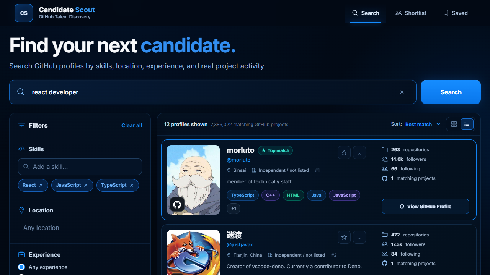

# Candidate Scout

GitHub talent discovery: search profiles by skills, location, experience and real project activity.

[](https://github.com/PHTMGatt/13-Candidate-Search/actions/workflows/verify.yml) [](https://one3-candidate-search-u82d.onrender.com)



A clean and responsive GitHub candidate viewer built with **React** and **TypeScript**. This app helps you explore potential developers from GitHub, presenting them in a modern UI with theme toggling, pagination, and plans for filtering and sorting features.

🔗 **Live Demo**: [https://one3-candidate-search-u82d.onrender.com](https://one3-candidate-search-u82d.onrender.com)

---

## Status

Checked 2026-11-26 on Windows with Node 26. `npm ci`, `npm run lint` and `npm run build` pass. The live demo and GitHub API calls were not re-tested. No test suite.

## ✨ Features

- 🔍 **GitHub API Integration** – View candidate profiles in real-time
- 🌙 **Light/Dark Mode** – Toggle themes with preserved readability
- 💾 **Local Storage** – Candidate data is saved across sessions
- 🧹 **Empty State Handling** – Clean fallback UI when no candidates are present
- 📦 **Fixed Layout** – Navbar and SideNav are always visible
- 📱 **Responsive Design** – Works on all screen sizes
- 🔢 **Pagination** – Paginated 3x3 grid display
- 🧠 **UI/UX Enhancements** – Hover effects, animations, and themed icons
- 🚧 **Planned**: Sorting and filtering by language, followers, activity

---

## 🛠️ Tech Stack

- **Framework**: React + TypeScript
- **Build tool**: Vite
- **Styling**: plain CSS
- **Icons**: React Icons
- **Routing**: React Router
- **API**: GitHub REST API
- **Deployment**: Render.com

---

## 🚀 Getting Started

Requires **Node.js 22.13+** (pinned in `.node-version`).

```bash
npm install
npm run dev       # dev server at http://localhost:5173
```

No API key or `.env` is needed: the app calls the public GitHub REST API without a token, so heavy use can hit GitHub's unauthenticated rate limit (the app shows a "rate limit reached" message when that happens).

## 📜 Scripts

| Command | What it does |
| --- | --- |
| `npm run dev` | Start the Vite dev server |
| `npm run lint` | ESLint, zero warnings allowed |
| `npm run build` | Type-check (`tsc`) and build to `dist/` |
| `npm start` / `npm run preview` | Serve the built `dist/` locally |

There is no test suite; CI (`.github/workflows/verify.yml`) runs `npm ci`, `npm run lint` and `npm run build` on every pull request.

## 📁 Project Structure

```
src/
  api/API.tsx          GitHub search + user lookups
  components/          CandidateCard, Nav, saved-candidate list
  pages/               CandidateSearch, SavedCandidates, ErrorPage
  interfaces/          Candidate types
```

Saved candidates live in the browser's `localStorage`.
